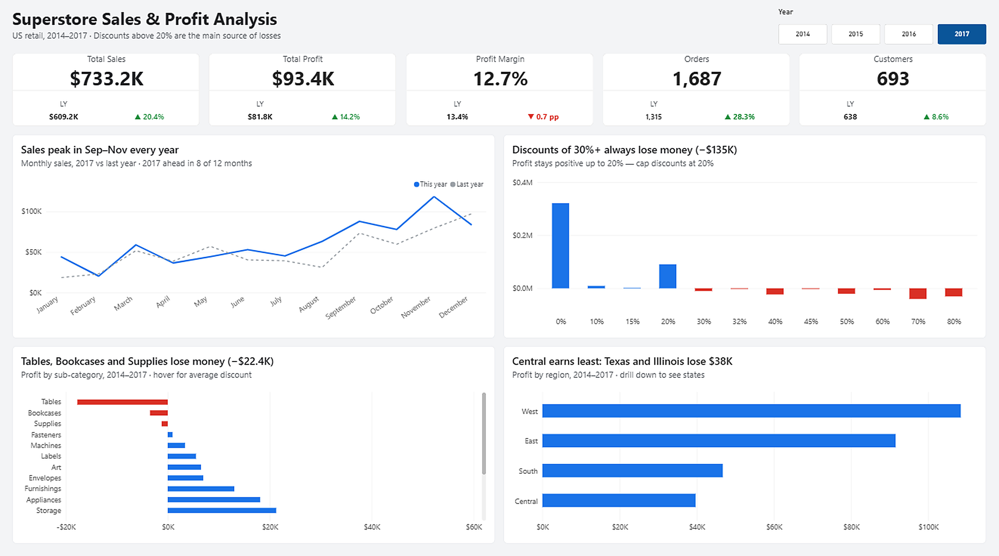
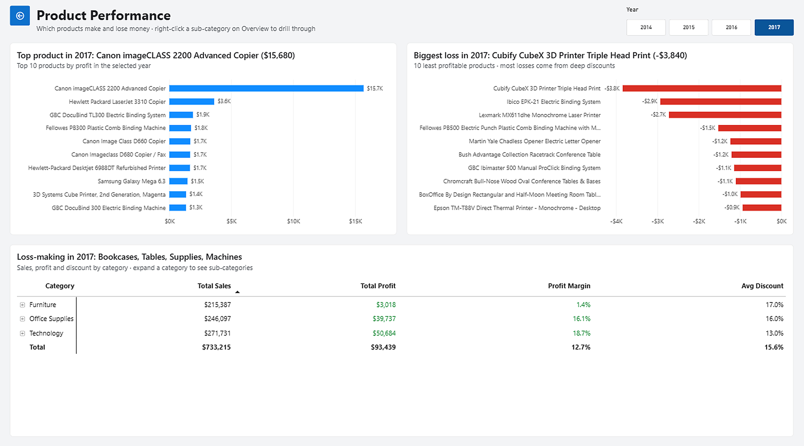

# Superstore Sales & Profit Analysis

A two-page Power BI report on four years of US retail orders (2014–2017). The main finding: the company is growing, but heavy discounting is destroying profit in specific products and regions.





## Key findings

| | |
|---|---|
| **Discounts** | Orders at discounts of 20% or less are profitable overall. Every discount level of 30% and above loses money, about **−$135K** in total. |
| **Sub-categories** | Tables (−$17.7K), Bookcases (−$3.5K) and Supplies (−$1.2K) lose money over the four years. |
| **Regions** | Central earns the least ($39.7K). Within Central, Texas (−$25.7K) and Illinois (−$12.6K) lose money. |
| **Products** | In 2017 the most profitable product, a Canon copier ($15,680), sold at an average 6.7% discount. Some loss-making products were discounted by up to 80%. |
| **2017 vs 2016** | Sales +20.4%, profit +14.2%, orders +28.3%, customers +8.6%, but margin fell 0.7 percentage points to 12.7%. |

**Recommendations:** cap discounts at 20%, review discounting in loss-making states such as Texas and Illinois, and review the pricing of Tables.

## Report pages

**Overview** answers "how is the business doing?" It has five KPI cards with last-year comparison, a monthly sales trend, and profit by discount level, sub-category and region. The year slicer controls only the KPIs and the trend. The other charts always show 2014–2017, so their long-term findings stay stable.

**Product Performance** answers "which products make and lose money?" It has the Top 10 and Bottom 10 products by profit and a Category → Sub-Category matrix. Right-clicking a sub-category on Overview drills through to this page, filtered to that sub-category.

## Data model

Star schema built in Power Query from one flat CSV file.

```
              Products
                 │
  Customers ── Sales ── Date
                 │
             Locations
```

| Table | Rows | Notes |
|---|---|---|
| Sales (fact) | 9,993 | One exact duplicate row removed |
| Customers | 793 | |
| Locations | 604 | Key combines city and state |
| Products | 1,894 | Key combines Product ID and name, because 32 Product IDs are shared by two different products |
| Date | 2014–2018 | DAX calendar table, marked as a date table |

Control totals: sales $2,296,919, profit $286,409, 5,009 orders.

## Techniques used

- **Power Query:** data cleaning, splitting a flat file into dimension tables, surrogate keys
- **DAX (21 measures):** `CALCULATE`, `SAMEPERIODLASTYEAR`, `DIVIDE`, `DISTINCTCOUNT`, `TOPN`, `FILTER`, `CONCATENATEX`, `SELECTEDVALUE`, variables
- **Dynamic titles:** chart titles are measures, so the text stays correct for any year or drillthrough
- **Report features:** drillthrough, synced slicers, Top N filters, edited visual interactions, rule-based conditional formatting

Example: margin change is shown in percentage points, with no value for the first year, which has no prior period.

```dax
Margin Change pp =
IF( ISBLANK( [Margin LY] ), BLANK(), ( [Profit Margin] - [Margin LY] ) * 100 )
```

## How to open

1. Download the [Sample Superstore dataset from Kaggle](https://www.kaggle.com/datasets/naveenkumar20bps1137/sample-superstore).
2. Open `superstore.pbip` in Power BI Desktop.
3. Go to **Transform data → Data source settings → Change Source** and point it to your copy of the CSV.
4. Select **Refresh**.

The dataset is not included in this repository.

## About this project

This is a learning project and the first in a series of Power BI portfolio projects. Sample Superstore is a public practice dataset, so the findings describe that dataset and not a real company.
